# 💰 Sistema de Finanzas Personales

Aplicación web para la gestión y el seguimiento de las finanzas personales, desarrollada con una arquitectura que integra frontend, API backend y base de datos relacional.

El proyecto permite organizar transacciones financieras, administrar presupuestos, establecer metas de ahorro y consultar informes para analizar la distribución de los ingresos y gastos.

La aplicación utiliza **Python, FastAPI, PostgreSQL, Docker Compose y Nginx**, con una estructura modular que separa las responsabilidades de la API, la lógica de negocio, el acceso a datos y la persistencia.

> **Objetivo del proyecto:** construir una aplicación de finanzas personales que permita poner en práctica el desarrollo de API REST, la gestión de bases de datos relacionales, la arquitectura por capas, las pruebas automatizadas y la contenerización de servicios.

---

## 📑 Tabla de contenidos

- [Capturas de pantalla](#-capturas-de-pantalla)
- [Funcionalidades](#-funcionalidades-principales)
- [Arquitectura](#️-arquitectura-del-proyecto)
- [Tecnologías](#️-tecnologías-utilizadas)
- [Estructura del proyecto](#-estructura-del-proyecto)
- [Organización del backend](#-organización-interna-del-backend)
- [Requisitos previos](#-requisitos-previos)
- [Instalación y ejecución](#-instalación-y-ejecución)
- [API REST](#-api-rest)
- [Base de datos y migraciones](#️-base-de-datos-y-migraciones)
- [Pruebas automatizadas](#-pruebas-automatizadas)
- [Comandos de Docker Compose](#-comandos-de-docker-compose)
- [Seguridad](#-seguridad)
- [Posibles mejoras](#-posibles-mejoras)
- [Autor](#-autor)
- [Licencia](#-licencia)

---

## 📸 Capturas de pantalla

Las siguientes capturas muestran las principales secciones de la aplicación, junto con los formularios para crear y administrar sus recursos.

### 1. Dashboard principal

Vista general de la aplicación, diseñada para ofrecer acceso a la información financiera más relevante desde una única pantalla.

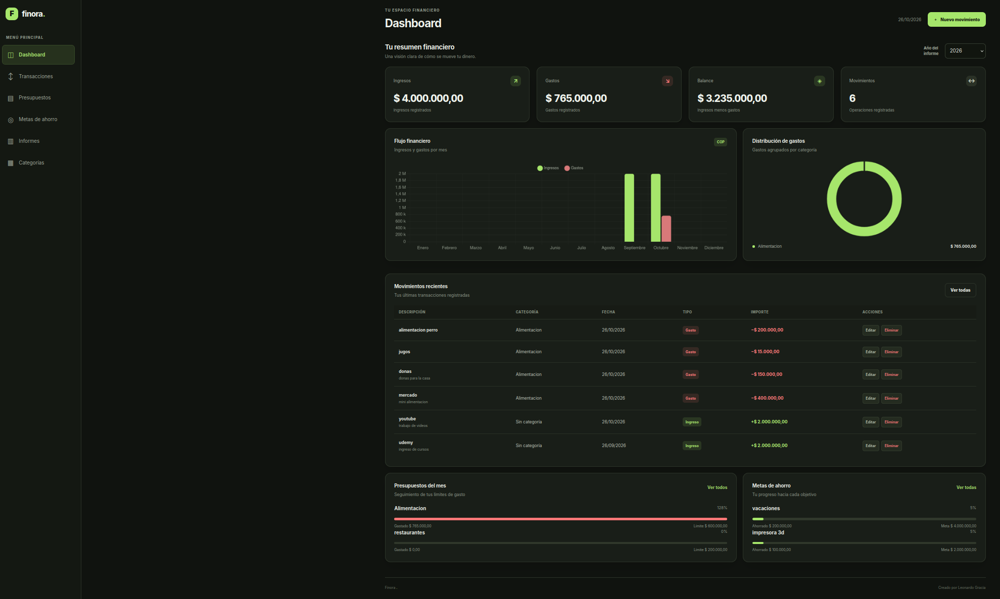

### 2. Transacciones financieras

Sección destinada a consultar y organizar los movimientos financieros registrados. Se utilizan transacciones de prueba para mostrar cómo se presenta la información.

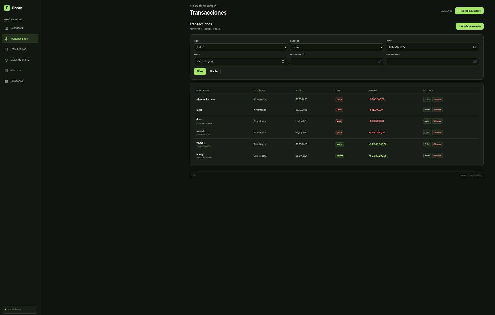

### 3. Presupuestos

Vista de los presupuestos configurados para controlar los gastos. Se muestran ejemplos dentro del límite establecido y otros que lo han superado.

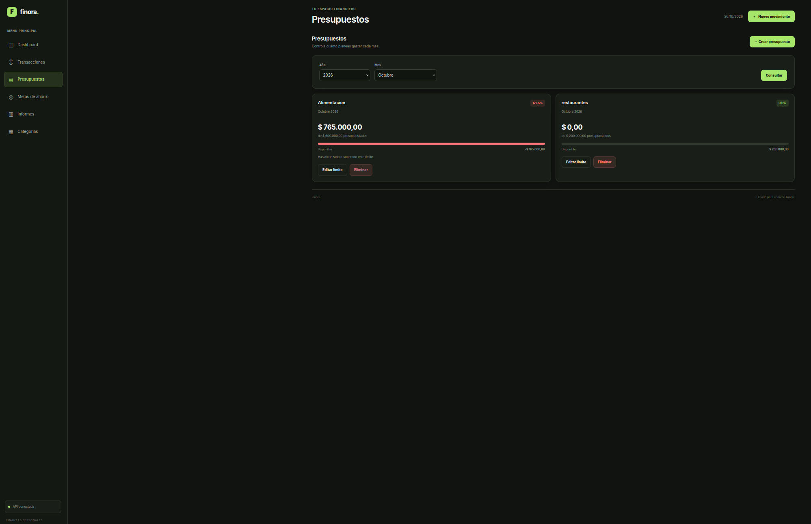

### 4. Metas de ahorro

Sección para consultar los objetivos de ahorro y los aportes registrados para cada meta, facilitando el seguimiento del progreso.

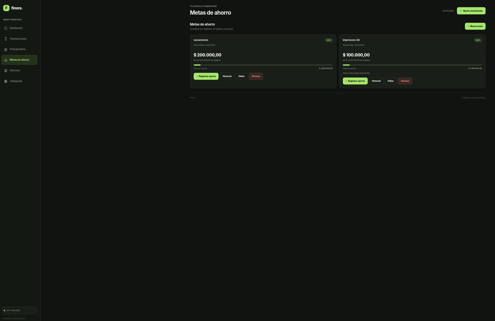

### 5. Informes financieros

Panel de informes con gráficas y distribución de gastos por categoría para facilitar la interpretación de los movimientos financieros.

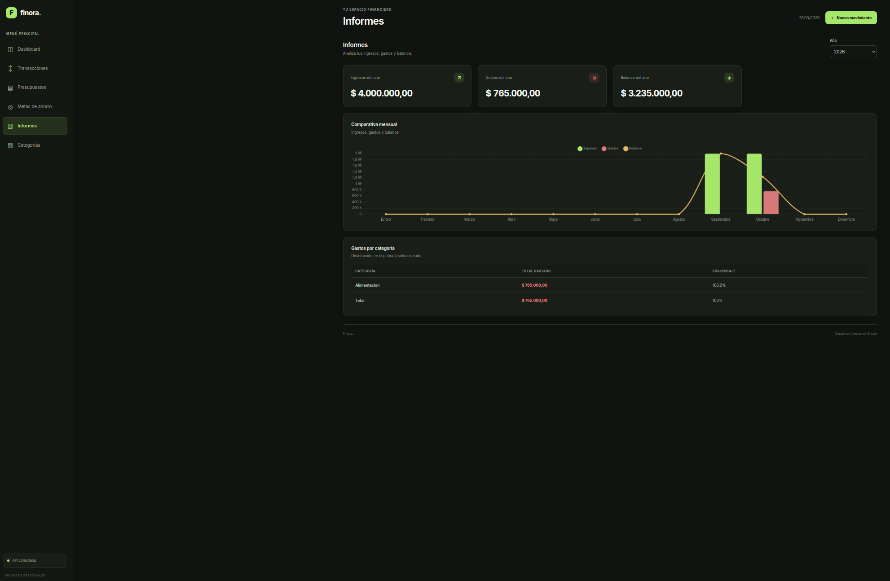

### 6. Categorías financieras

Vista de las categorías disponibles para clasificar y organizar los ingresos y gastos.

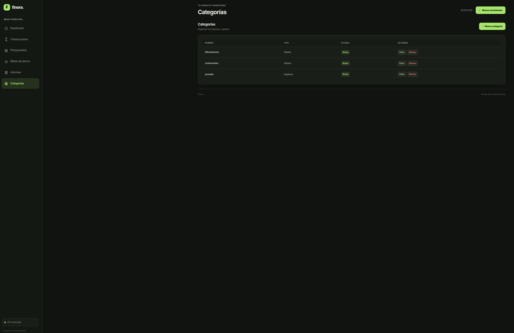

### 7. Formulario de nueva transacción

Panel para introducir los datos de una nueva operación financiera y registrarla en el sistema.

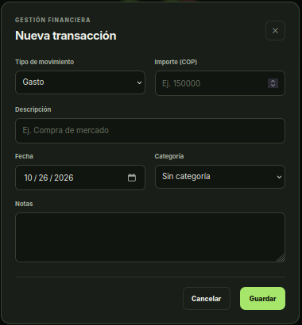

### 8. Formulario de nuevo presupuesto

Panel para crear un presupuesto y establecer los parámetros necesarios para el seguimiento de los gastos.

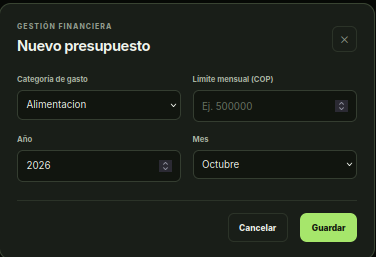

### 9. Formulario de nueva meta de ahorro

Panel para configurar un nuevo objetivo de ahorro y sus valores iniciales.

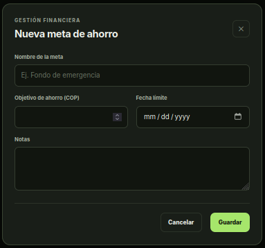

### 10. Formulario de nueva categoría

Panel para registrar una categoría que permita clasificar las transacciones financieras.

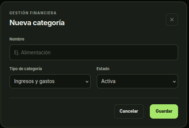

---

## ✨ Funcionalidades principales

### 📊 Dashboard financiero

- Vista general de la información financiera.
- Presentación de indicadores y datos disponibles.
- Acceso a las principales secciones de la aplicación.
- Organización visual de la información para facilitar su consulta.

### 💳 Transacciones

- Gestión de movimientos financieros.
- Organización de ingresos y gastos.
- Clasificación de movimientos mediante categorías.
- Consulta de las transacciones registradas.

### 🎯 Presupuestos

- Creación y administración de presupuestos.
- Definición de límites de gasto.
- Seguimiento del gasto frente al presupuesto establecido.
- Identificación de presupuestos que han superado su límite.

### 🐷 Metas de ahorro

- Creación de objetivos de ahorro.
- Configuración de metas financieras.
- Registro de aportes a cada meta.
- Consulta del progreso de los objetivos.

### 📈 Informes financieros

- Visualización gráfica de información financiera.
- Distribución de los gastos por categoría.
- Presentación de datos para analizar los movimientos registrados.

### 🗂️ Categorías

- Creación y administración de categorías.
- Clasificación de las transacciones.
- Organización de la información para facilitar el análisis financiero.

---

## 🏗️ Arquitectura del proyecto

La aplicación utiliza una arquitectura compuesta por servicios independientes que se comunican mediante la red interna de Docker Compose.

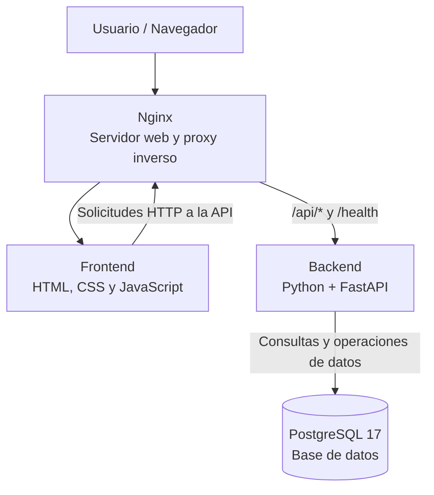

### Componentes de la arquitectura

| Componente | Tecnología | Responsabilidad |
|---|---|---|
| Interfaz de usuario | HTML, CSS y JavaScript | Presentar información y permitir la interacción con la aplicación. |
| Servidor web | Nginx | Entregar los archivos del frontend y redirigir las solicitudes configuradas hacia el backend. |
| API backend | Python y FastAPI | Procesar solicitudes HTTP y ejecutar la lógica de la aplicación. |
| Persistencia | PostgreSQL 17 | Almacenar la información financiera. |
| Migraciones | Alembic | Gestionar cambios versionados en el esquema de la base de datos. |
| Contenerización | Docker | Empaquetar los servicios en imágenes y contenedores. |
| Orquestación local | Docker Compose | Definir, conectar y ejecutar los servicios del proyecto. |

### Flujo de una solicitud

1. El usuario accede a la aplicación desde el navegador.
2. Nginx entrega los archivos de la interfaz web.
3. El frontend envía solicitudes HTTP cuando necesita consultar o modificar información.
4. Nginx redirige las solicitudes de las rutas configuradas de la API a FastAPI.
5. El backend procesa la operación y accede a PostgreSQL cuando es necesario.
6. La API devuelve una respuesta que el frontend utiliza para actualizar la información presentada.

Esta separación facilita el mantenimiento, permite probar componentes de forma independiente y reduce el acoplamiento entre la interfaz, la lógica de negocio y la persistencia.

---

## 🛠️ Tecnologías utilizadas

### Backend

- **Python:** lenguaje de programación utilizado para implementar la lógica del servidor.
- **FastAPI:** framework para desarrollar la API REST.
- **SQLAlchemy:** capa de acceso a datos relacionales, utilizada según la configuración del backend.
- **Alembic:** herramienta para gestionar migraciones de base de datos.
- **Psycopg:** controlador de PostgreSQL para Python.
- **PostgreSQL 17:** sistema de gestión de bases de datos relacionales.

### Frontend

- **HTML5:** estructura de la interfaz.
- **CSS3:** estilos, distribución y presentación visual.
- **JavaScript:** interacciones y comunicación con la API.
- **Nginx:** servidor web y proxy inverso.

### Infraestructura y herramientas

- **Docker:** ejecución de los servicios en contenedores.
- **Docker Compose:** definición y coordinación de los servicios.
- **Git:** control de versiones.
- **GitHub:** alojamiento del código fuente y documentación del proyecto.

---

## 📂 Estructura del proyecto

La estructura está organizada por responsabilidades. Se omiten los archivos `__pycache__`, los archivos compilados `.pyc` y los archivos `__init__.py` repetitivos para mantener el árbol legible.

```text
ProyectoFinanzasPersonales/
├── assets/
│   ├── imagen_01.png
│   ├── imagen_02.png
│   ├── imagen_03.png
│   ├── imagen_04.png
│   ├── imagen_05.png
│   ├── imagen_06.png
│   ├── imagen_07.png
│   ├── imagen_08.png
│   ├── imagen_09.png
│   └── imagen_10.png
│
├── backend/
│   ├── alembic/
│   │   ├── env.py
│   │   ├── script.py.mako
│   │   └── versions/
│   │       └── 0001_initial_schema.py
│   │
│   ├── app/
│   │   ├── api/
│   │   │   └── routes/
│   │   │       ├── budgets.py
│   │   │       ├── categories.py
│   │   │       ├── finance.py
│   │   │       ├── reports.py
│   │   │       ├── savings_goals.py
│   │   │       └── transactions.py
│   │   │
│   │   ├── core/
│   │   │   ├── config.py
│   │   │   └── exceptions.py
│   │   │
│   │   ├── database/
│   │   │   ├── base.py
│   │   │   ├── connection.py
│   │   │   └── session.py
│   │   │
│   │   ├── models/
│   │   │   ├── budget.py
│   │   │   ├── category.py
│   │   │   ├── savings_contribution.py
│   │   │   ├── savings_goal.py
│   │   │   └── transaction.py
│   │   │
│   │   ├── repositories/
│   │   │   ├── budget_repository.py
│   │   │   ├── category_repository.py
│   │   │   ├── savings_repository.py
│   │   │   └── transaction_repository.py
│   │   │
│   │   ├── schemas/
│   │   │   ├── budget.py
│   │   │   ├── category.py
│   │   │   ├── finance.py
│   │   │   ├── report.py
│   │   │   ├── savings_goal.py
│   │   │   └── transaction.py
│   │   │
│   │   ├── services/
│   │   │   ├── budget_service.py
│   │   │   ├── category_service.py
│   │   │   ├── finance_service.py
│   │   │   ├── report_service.py
│   │   │   ├── savings_service.py
│   │   │   └── transaction_service.py
│   │   │
│   │   ├── utils/
│   │   │   └── pagination.py
│   │   │
│   │   ├── validators/
│   │   │   ├── budget_validator.py
│   │   │   ├── category_validator.py
│   │   │   └── transaction_validator.py
│   │   │
│   │   └── main.py
│   │
│   ├── tests/
│   │   ├── integration/
│   │   │   ├── test_budgets.py
│   │   │   ├── test_categories.py
│   │   │   ├── test_reports.py
│   │   │   └── test_transactions.py
│   │   │
│   │   ├── unit/
│   │   │   ├── test_budget_service.py
│   │   │   ├── test_finance_service.py
│   │   │   ├── test_savings_service.py
│   │   │   └── test_transaction_service.py
│   │   │
│   │   └── conftest.py
│   │
│   ├── Dockerfile
│   ├── alembic.ini
│   └── requirements.txt
│
├── frontend/
│   ├── index.html
│   ├── styles.css
│   ├── script.js
│   ├── nginx.conf
│   └── Dockerfile
│
├── compose.yaml
├── .env.example
├── .gitignore
└── README.md
```

> El árbol muestra los archivos principales identificados durante el desarrollo. Si se agregan nuevos módulos o archivos de configuración, conviene actualizar esta sección.

---

## 🧩 Organización interna del backend

El backend utiliza una separación por capas para distribuir las responsabilidades y facilitar el mantenimiento del código.

### `app/api/routes/` — Endpoints de la API

Contiene los módulos que exponen las operaciones HTTP de la aplicación.

| Archivo | Responsabilidad |
|---|---|
| `transactions.py` | Operaciones relacionadas con las transacciones. |
| `categories.py` | Operaciones relacionadas con las categorías. |
| `budgets.py` | Operaciones relacionadas con los presupuestos. |
| `savings_goals.py` | Operaciones relacionadas con las metas de ahorro. |
| `finance.py` | Consultas y operaciones financieras. |
| `reports.py` | Endpoints relacionados con los informes. |

Esta capa recibe las solicitudes, delega el procesamiento a los componentes correspondientes y devuelve las respuestas HTTP.

### `app/services/` — Lógica de negocio

Contiene los servicios que agrupan las operaciones de cada módulo.

- `transaction_service.py`: lógica relacionada con transacciones.
- `category_service.py`: operaciones de negocio de las categorías.
- `budget_service.py`: lógica relacionada con presupuestos.
- `savings_service.py`: operaciones relacionadas con metas y aportes de ahorro.
- `finance_service.py`: operaciones financieras.
- `report_service.py`: preparación de información para los informes.

Separar la lógica de negocio de los endpoints permite probar los servicios independientemente de las rutas HTTP.

### `app/repositories/` — Acceso a datos

Agrupa los componentes encargados de las operaciones de persistencia.

- `transaction_repository.py`
- `category_repository.py`
- `budget_repository.py`
- `savings_repository.py`

Esta capa separa las operaciones de acceso a los datos de la lógica de negocio.

### `app/models/` — Modelos de datos

Contiene los modelos asociados a las principales entidades financieras:

- `transaction.py`: transacciones.
- `category.py`: categorías.
- `budget.py`: presupuestos.
- `savings_goal.py`: metas de ahorro.
- `savings_contribution.py`: aportes a metas de ahorro.

Estos modelos representan las entidades utilizadas por el backend y su relación con la persistencia.

### `app/schemas/` — Esquemas de entrada y salida

Define los esquemas asociados a los datos intercambiados mediante la API.

- `transaction.py`
- `category.py`
- `budget.py`
- `savings_goal.py`
- `finance.py`
- `report.py`

Los esquemas permiten establecer la estructura de las solicitudes y respuestas y validar los datos cuando así se configura.

### `app/validators/` — Validaciones

Contiene validadores específicos para:

- Transacciones.
- Categorías.
- Presupuestos.

Esta organización permite centralizar las reglas de validación que utiliza la aplicación.

### `app/database/` — Conexión a la base de datos

- `connection.py`: configuración de la conexión.
- `session.py`: gestión de las sesiones de acceso a datos.
- `base.py`: definición de la base común para los modelos, según la implementación.

### `app/core/` — Configuración y excepciones

- `config.py`: configuración central de la aplicación.
- `exceptions.py`: excepciones utilizadas para gestionar errores.

### `app/utils/` — Utilidades compartidas

- `pagination.py`: utilidades relacionadas con la paginación de resultados.

### `alembic/` — Migraciones

Contiene la configuración y las revisiones versionadas del esquema de PostgreSQL.

- `env.py`: configuración del entorno de migraciones.
- `versions/0001_initial_schema.py`: migración inicial registrada.
- `alembic.ini`: configuración de Alembic.

Las migraciones permiten versionar los cambios del esquema y evolucionar la base de datos de forma controlada.

### `tests/` — Pruebas automatizadas

Las pruebas están organizadas en dos grupos.

**Pruebas unitarias (`tests/unit/`)**

Incluyen pruebas de servicios de presupuestos, finanzas, ahorro y transacciones.

**Pruebas de integración (`tests/integration/`)**

Incluyen pruebas para presupuestos, categorías, informes y transacciones.

El archivo `conftest.py` contiene configuración y recursos compartidos para las pruebas.

### Flujo interno de una operación

Una operación típica puede seguir este recorrido, según el endpoint:

1. La ruta recibe la solicitud HTTP.
2. Los esquemas y validadores aplicables comprueban la estructura y las reglas correspondientes.
3. El servicio ejecuta la lógica de negocio.
4. El repositorio realiza las operaciones de persistencia necesarias.
5. PostgreSQL almacena o devuelve la información.
6. La API prepara y devuelve la respuesta.

---

## 📋 Requisitos previos

Para ejecutar el proyecto localmente necesitas:

- Git.
- Docker Engine o Docker Desktop.
- Docker Compose v2.
- Puertos `5432`, `8000` y `8080` disponibles, según la configuración actual.

No es necesario instalar PostgreSQL ni configurar Nginx directamente en el sistema operativo, ya que estos servicios se ejecutan en contenedores.

---

## 🚀 Instalación y ejecución

### 1. Clonar el repositorio

```bash
git clone URL_DE_TU_REPOSITORIO
cd ProyectoFinanzasPersonales
```

Reemplaza `URL_DE_TU_REPOSITORIO` por la dirección real de tu repositorio de GitHub.

### 2. Configurar las variables de entorno

Crea un archivo `.env` en la raíz del proyecto. Las variables deben coincidir con las utilizadas en `compose.yaml`.

Ejemplo:

```dotenv
POSTGRES_DB=finanzas_personales
POSTGRES_USER=finanzas_user
POSTGRES_PASSWORD=REEMPLAZAR_POR_UNA_CLAVE_SEGURA
```

Utiliza credenciales propias y seguras. No publiques contraseñas reales en el repositorio.

### 3. Construir y ejecutar la aplicación

Desde la raíz del proyecto, ejecuta:

```bash
docker compose up -d --build
```

Docker Compose construirá las imágenes necesarias e iniciará los servicios.

### 4. Comprobar el estado de los contenedores

```bash
docker compose ps
```

Comprueba que el frontend, el backend y la base de datos estén en ejecución. PostgreSQL debe superar su comprobación de salud antes de que el backend pueda arrancar, de acuerdo con la configuración de dependencias.

### 5. Acceder a la aplicación

| Servicio | Dirección local |
|---|---|
| Aplicación web | http://localhost:8080 |
| API backend | http://localhost:8000 |
| Swagger UI | http://localhost:8000/docs |
| ReDoc | http://localhost:8000/redoc |
| Endpoint de salud | http://localhost:8000/health |

Si el endpoint de salud también está configurado mediante Nginx, puedes comprobarlo en `http://localhost:8080/health`.

Las direcciones corresponden a la configuración local predeterminada y pueden cambiar si se modifican los puertos o las rutas.

---

## 🔌 API REST

El backend expone endpoints HTTP para gestionar la información financiera. FastAPI proporciona documentación interactiva que permite inspeccionar las rutas implementadas y probar sus solicitudes.

### Documentación interactiva

Con el backend en ejecución, accede a:

- **Swagger UI:** http://localhost:8000/docs
- **ReDoc:** http://localhost:8000/redoc

Estas interfaces permiten consultar los endpoints disponibles, sus métodos HTTP, los parámetros, los esquemas y las respuestas definidas en el código.

### Módulos de la API

| Módulo | Propósito |
|---|---|
| Transacciones | Gestionar movimientos financieros. |
| Categorías | Organizar y clasificar los movimientos. |
| Presupuestos | Administrar límites de gasto. |
| Metas de ahorro | Gestionar objetivos y aportes de ahorro. |
| Finanzas | Exponer consultas y operaciones financieras. |
| Informes | Consultar información para los reportes. |

Las rutas, los métodos, los parámetros y los códigos de respuesta exactos deben consultarse en `/docs`, porque dependen de los endpoints implementados.

---

## 🗄️ Base de datos y migraciones

La aplicación utiliza PostgreSQL 17 como sistema de gestión de bases de datos relacionales.

Docker Compose declara un volumen persistente para almacenar los datos de PostgreSQL y permitir que sobrevivan a las recreaciones normales de los contenedores.

### Consultar los registros de PostgreSQL

```bash
docker compose logs db
```

### Consultar los registros del backend

```bash
docker compose logs --tail=100 backend
```

### Migraciones con Alembic

El proyecto incorpora Alembic para gestionar los cambios versionados del esquema de la base de datos.

Las migraciones permiten mantener una evolución controlada del esquema sin depender de la eliminación y recreación de la base de datos.

**Importante:** no es necesario eliminar el volumen de PostgreSQL para aplicar cambios normales en el código. Antes de ejecutar operaciones destructivas, realiza una copia de seguridad y verifica qué recursos serán eliminados.

---

## 🧪 Pruebas automatizadas

El proyecto contiene pruebas unitarias y de integración con archivos organizados por módulo.

### Pruebas unitarias

Ubicación: `backend/tests/unit/`

Incluyen archivos para probar servicios relacionados con:

- Presupuestos.
- Finanzas.
- Metas de ahorro.
- Transacciones.

### Pruebas de integración

Ubicación: `backend/tests/integration/`

Incluyen archivos relacionados con:

- Presupuestos.
- Categorías.
- Informes.
- Transacciones.

### Ejecutar las pruebas

El proyecto contiene un archivo `requirements.txt`, pero el comando exacto depende de dónde estén instaladas las dependencias y de cómo esté configurado el entorno de pruebas.

Si las dependencias de prueba están instaladas en el entorno virtual local, desde la raíz puedes probar:

```bash
python -m pytest backend/tests -v
```

Si `pytest` no está instalado en ese entorno, instala las dependencias de desarrollo que correspondan al proyecto antes de ejecutar las pruebas.

La existencia de archivos de prueba no implica que todas las pruebas estén pasando. Los resultados deben comprobarse ejecutándolas.

---

## 🐳 Comandos de Docker Compose

Ejecuta los siguientes comandos desde la raíz del proyecto.

### Iniciar los servicios

```bash
docker compose up -d
```

### Construir las imágenes y arrancar

```bash
docker compose up -d --build
```

### Reconstruir sin caché

```bash
docker compose build --no-cache
docker compose up -d --force-recreate
```

### Consultar el estado de los servicios

```bash
docker compose ps
```

### Ver los registros de todos los servicios

```bash
docker compose logs -f
```

### Ver los registros de un servicio concreto

```bash
docker compose logs -f frontend
docker compose logs -f backend
docker compose logs -f db
```

### Detener los servicios

```bash
docker compose stop
```

### Iniciar los servicios detenidos

```bash
docker compose start
```

### Detener y eliminar los contenedores del proyecto

```bash
docker compose down
```

Este comando elimina los contenedores y la red del proyecto, pero no elimina por sí solo el volumen nombrado de PostgreSQL.

> **Advertencia:** evita `docker compose down -v` si necesitas conservar los datos de la base de datos, porque la opción `-v` puede eliminar los volúmenes declarados por el proyecto.

---

## 🔐 Seguridad y configuración

Para mantener el proyecto seguro y facilitar su despliegue:

- No subir credenciales, tokens ni contraseñas al repositorio.
- Mantener el archivo `.env` fuera del control de versiones.
- Proporcionar un `.env.example` con valores ficticios.
- Validar los datos recibidos por la API.
- Gestionar adecuadamente los errores y las respuestas HTTP.
- Revisar la exposición de los puertos en entornos públicos.
- Mantener las dependencias actualizadas.
- Realizar copias de seguridad de la base de datos.
- Utilizar datos ficticios en capturas y demostraciones públicas.

La configuración local no debe considerarse automáticamente apta para producción. Un despliegue público requiere revisar autenticación, autorización, HTTPS, gestión de secretos, copias de seguridad, monitorización y configuración de red.

---

## 🗺️ Posibles mejoras futuras

Las siguientes ideas constituyen una hoja de ruta potencial y no implican que ya estén implementadas:

- Incorporar autenticación y autorización de usuarios.
- Separar los datos financieros por usuario.
- Ampliar las pruebas unitarias y de integración.
- Mejorar el manejo de errores y la validación de datos.
- Incorporar filtros, ordenamiento y paginación de transacciones.
- Permitir exportar informes a CSV o PDF.
- Añadir notificaciones configurables para presupuestos.
- Mejorar la accesibilidad y la adaptación a dispositivos móviles.
- Implementar un pipeline CI/CD para ejecutar pruebas automáticamente.
- Desplegar la aplicación en un entorno cloud.
- Incorporar monitorización, registros estructurados y copias de seguridad automatizadas.

---

## 🎓 Objetivos de aprendizaje

Este proyecto permite demostrar y practicar conocimientos relacionados con:

- Desarrollo de API REST con Python y FastAPI.
- Diseño de una arquitectura backend modular.
- Gestión de bases de datos relacionales con PostgreSQL.
- Organización de la lógica de negocio mediante servicios.
- Separación del acceso a datos mediante repositorios.
- Definición de esquemas y validación de solicitudes.
- Gestión de migraciones con Alembic.
- Desarrollo y ejecución de pruebas automatizadas.
- Comunicación entre frontend y backend.
- Configuración de Nginx como servidor web y proxy inverso.
- Contenerización con Docker.
- Orquestación local con Docker Compose.
- Configuración mediante variables de entorno.
- Documentación técnica y control de versiones con Git.

---

## 👨‍💻 Autor

**Leonardo Gracia**

Ingeniero Electrónico orientado al desarrollo de software, con interés en el desarrollo backend, las API REST, las bases de datos y las tecnologías de contenedores.

- **GitHub:** [overrun1026](https://github.com/overrun1026)
- **LinkedIn:** [Leonardo Gracia](https://www.linkedin.com/in/leonardo-gracia-71222124b/)
- **Correo electrónico:** leo.gracia970607@hotmail.com

---

## 📄 Licencia

Este proyecto está distribuido bajo la Licencia MIT. Puedes consultar el archivo LICENSE para conocer los permisos y las condiciones de uso, modificación y distribución del código.

---

<p align="center">
  <strong>Sistema de Finanzas Personales</strong><br>
  Aplicación web desarrollada con Python, FastAPI, PostgreSQL, Docker Compose y Nginx.
</p>
